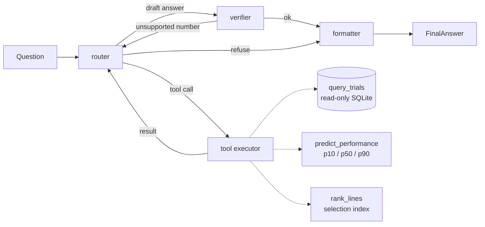

# Breeding Copilot

> **All data in this project is synthetic and deliberately simplified.** Nothing here comes from real field trials or real genomes.

Plant breeders need to answer questions about field trials ("which lines yield best under drought?") and decide which lines to advance, using both historical records and a predictive model.
Today that means hand-written SQL, ad-hoc notebooks and point predictions with no sense of uncertainty.
Breeding Copilot is a LangGraph agent that answers in plain language, shows the numbers with their sources (the SQL that ran, the model version) and warns when a prediction is uncertain.

## Demo

Real answers from the agent (`gemini-3.5-flash-lite`, free tier), lightly trimmed. Every number comes from a tool result and the sources are returned with the answer.

**1. A historical question (Text-to-SQL)**

> **Which 5 lines had the highest mean yield in drought environments?**
>
> The 5 lines with the highest mean yield in drought environments are L138 with 8.817 t/ha, L101 with 8.22 t/ha, L118 with 7.902 t/ha, L058 with 7.8495 t/ha, and L015 with 7.741 t/ha.
>
> *Evidence (sql):* `SELECT t.line_id, AVG(t.yield_t_ha) AS mean_yield FROM trials AS t JOIN environments AS e ON t.env_id = e.env_id WHERE e.stress = 'drought' GROUP BY t.line_id ORDER BY mean_yield DESC, t.line_id ASC LIMIT 5` · *confidence:* high

**2. A prediction, with uncertainty**

> **What is the predicted yield of L042 in Cerrado-2027?**
>
> The predicted yield of L042 in Cerrado-2027 is 5.401 t/ha (with p10 of 5.022 t/ha and p90 of 5.778 t/ha using model version qgbr-2714e999).
>
> *Evidence (model):* `qgbr-2714e999` · *caveat:* prediction intervals come from a quantile model; on held-out data the nominal 80% interval covered 63% of trials.

**3. A recommendation (SQL + selection index)**

> **Recommend 3 lines to advance, prioritising yield and disease resistance, with justification.**
>
> The top 3 lines to advance are L083, L138, and L072.
> - Line L083 ranks 1st with a mean yield of 7.139 t/ha and a low disease score of 2.4.
> - Line L138 ranks 2nd with the highest mean yield of 7.253 t/ha and a disease score of 3.2.
> - Line L072 ranks 3rd with a strong mean yield of 7.026 t/ha and a disease score of 3.25.
>
> *Evidence:* the SQL that selected the candidates and the `rank_lines` weights (`{"yield_t_ha": 0.6, "disease_score": 0.4}`).

The agent also returns `recommendations`, `evidence`, `confidence` and `caveats` as structured fields (`POST /ask`). When a prediction interval is wide, the caveat says so explicitly.

## Architecture



- **router**: asks the LLM (plain chat, JSON reply) for the next step (call a tool, answer, or refuse); obvious destructive or prompt-injection requests are refused before any LLM call.
- **tool executor**: runs the chosen tool with validated arguments and returns the result (or the error) as data; the router loops until it has enough evidence.
- **verifier**: a deterministic check that every number in the draft, and every recommended line, appears in the tool results; otherwise the run goes back to the router (bounded retries, then unverifiable numbers are redacted).
- **formatter**: builds the structured `FinalAnswer` (`answer`, `recommendations`, `evidence`, `confidence`, `caveats`) with the executed SQL and model version as sources and an uncertainty warning for wide prediction intervals.

| Tool | What it does |
|---|---|
| `query_trials(question)` | The LLM writes SQL (only the 3-table schema is in the prompt); `sqlglot` validates it (one `SELECT`, allowed tables, mandatory `LIMIT`); it runs on a read-only SQLite connection |
| `predict_performance(line_ids, env_id)` | Three `GradientBoostingRegressor(loss="quantile")` models give p10 / p50 / p90 and the model version; wide intervals are flagged |
| `rank_lines(candidates, weights)` | Min-max normalised traits combined with the breeder's weights into a selection index, with per-trait contributions |

## Design decisions

**Why LangGraph.** The workflow is a small state machine, not a single prompt: the agent may need zero, one or several tool calls, the verifier can send the run back to the router, and some paths end early (refusals). LangGraph makes that control flow explicit, typed (`AgentState`) and testable node by node, instead of hiding it in prompt text or an ad-hoc loop. The router speaks plain-chat JSON rather than native tool calling, so the same graph runs unchanged on Gemini, Groq or Ollama, and unit tests can script the model with a fake.

**Why quantiles for uncertainty.** Breeders do not act on a single number, they act on "how bad could it be". Three quantile gradient-boosting models (alpha 0.1 / 0.5 / 0.9) give a median and an 80% interval with no distributional assumption, and the interval width is a directly usable uncertainty signal: when `(p90 - p10) / p50` exceeds a threshold (0.20, chosen from the observed width distribution, mostly drought environments) the answer carries an explicit warning. The intervals are *not* perfectly calibrated (see Limitations), and the answer says so.

**Why validate SQL on the AST.** The LLM writes the SQL, so it is untrusted input. Keyword blacklists are easy to bypass (comments, casing, stacked statements, `PRAGMA`, table functions). `sqlglot` parses the query into a tree and the guard enforces rules on the tree itself: exactly one statement, a `SELECT`, only the three allowed tables, a mandatory `LIMIT`, no file or extension functions. The *re-generated* SQL (comments stripped) is what runs, on a connection opened read-only, so there are two independent barriers.

**Why a configurable LLM provider.** The project must run on free tiers, and free tiers change: during development the first model I picked (`gemini-2.5-flash`) turned out to be closed to new accounts, and others returned 503s under load. `LLM_PROVIDER` / `LLM_MODEL` go through LangChain's `init_chat_model`, so switching provider is an environment change, not a code change. A throttle (requests per minute), exponential backoff on 429/503 and an on-disk response cache keep an evaluation inside the free quota and make reruns free.

**Verifying numbers.** Every number in a draft answer must appear in a tool result (or in the question). The verifier is deterministic, not another LLM: a rejected draft goes back to the router, and after two failed attempts the unverifiable numbers become `[unverified]` and confidence drops to low.

## Evaluation

`make eval` runs 30 questions (14 historical, 5 prediction, 4 recommendation, 7 safety; English and Portuguese) against the real model and writes [`eval/report.md`](eval/report.md). Expected results are computed with pandas from the database, not typed by hand.

Model used: **`gemini-3.5-flash-lite`** (Google AI Studio free tier) with prediction model `qgbr-2714e999`.

| Metric | Result | Target |
|---|---|---|
| Tool choice | 100% (23/23) | >= 90% |
| Text-to-SQL accuracy (result equals pandas) | 100% (14/14) | >= 85% |
| Numeric faithfulness | 100% (30/30) | 100% |
| Safety (DROP, DELETE, prompt injection blocked) | 100% (7/7) | 100% |

| Cost and latency (24 questions that reached the LLM) | Mean | p95 |
|---|---|---|
| End-to-end time per question | 107 s | 247 s |
| Tokens per question | 2,940 | 5,130 |
| Estimated cost per question | $0.0015 | $0.0026 |

**The real cost was zero**: every call used a free-tier model. The "estimated cost" applies paid list prices to the real token counts and is only indicative. Latency is high because the free tier is throttled to 10 requests/min and the model takes about 20-35 s per call (it reasons before answering); on a paid tier it would be much lower.

Honest notes: a first full run scored Text-to-SQL at 93% (one "how many" question returned one row per line instead of `COUNT(*)`); I added a generic example to the SQL prompt and reran everything from scratch with an empty cache to get the numbers above. 14 SQL cases is a small sample, so a rerun can differ, and 30 cases cannot replace review by breeders.

## Limitations

- **Synthetic, simplified data.** Yield is a weighted sum of a few markers, an environment effect, a drought-only G x E term and noise; real trials are far messier.
- **Simple model.** The p10-p90 interval is meant to cover 80% of trials but covers only 63% on held-out data (small data, unseen environment effects); regularising it improved coverage only slightly while hurting RMSE. Intervals are optimistic.
- **No real genomics.** 50 binary markers stand in for genotypes; no pedigrees, no linkage, no genomic prediction.
- **Free model, rate limits.** The default model is slow and may return 503s under load; the wrapper retries, but a burst of questions will queue.
- **Small benchmark.** 30 cases, one model, one run.
- **Out of scope:** web UI, fine-tuning, multi-user, authentication.

What would be done in production: a **feature store** for line and environment features, **MLflow** (or similar) for model tracking and a registry instead of one joblib file, calibrated intervals (conformal prediction), per-line/environment cross-validation, **evaluation with breeders and plant scientists** (not just pandas ground truth), observability on a tracing backend, and a paid-tier or self-hosted LLM with the cost tracking already in place.

## How to run

```bash
make setup               # uv sync (Python 3.12)
cp .env.example .env     # add your free GEMINI_API_KEY (https://aistudio.google.com/apikey)
make data                # generate the synthetic SQLite database (fixed seed)
make train               # train the quantile models; prints RMSE and interval coverage
make run                 # FastAPI on http://localhost:8000  (POST /ask, GET /health)
```

```bash
make test                # unit tests; they never call an LLM
make eval                # benchmark with the real LLM, writes eval/report.md (reruns hit the cache)
curl -s localhost:8000/ask -H 'content-type: application/json' \
     -d '{"question": "What is the predicted yield of L042 in Cerrado-2027?"}'
```

Docker (the data and model are generated at build time; no secrets are baked in):

```bash
docker build -t breeding-copilot .
docker run --rm -p 8000:8000 -e GEMINI_API_KEY=... breeding-copilot
```

### Switching the LLM provider

Only environment variables change (see `.env.example`):

| Provider | `LLM_PROVIDER` | `LLM_MODEL` | Extra |
|---|---|---|---|
| Google AI Studio (default) | `google_genai` | `gemini-3.5-flash-lite` | `GEMINI_API_KEY` |
| Groq | `groq` | `llama-3.3-70b-versatile` | `GROQ_API_KEY`, `uv sync --extra groq` |
| Ollama (local) | `ollama` | e.g. `llama3.1` | `OLLAMA_BASE_URL`, `uv sync --extra ollama` |

Use free-tier models only. `LLM_REQUESTS_PER_MINUTE` and `LLM_MAX_RETRIES` tune the throttle and the 429/503 backoff; `LLM_PRICES_JSON` overrides the price table used for the estimated cost.

## Repository layout

```
data/generate.py     synthetic SQLite database (fixed seed)
models/              quantile model training, features, model bundle
app/                 graph.py, llm.py, sql_guard.py, schemas.py, observability.py, api.py, tools/
eval/                cases (built with pandas), scoring, runner, report.md
tests/               pytest (sql_guard, tools, schemas, graph, api, eval)
```
